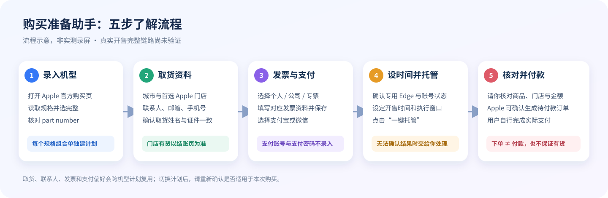
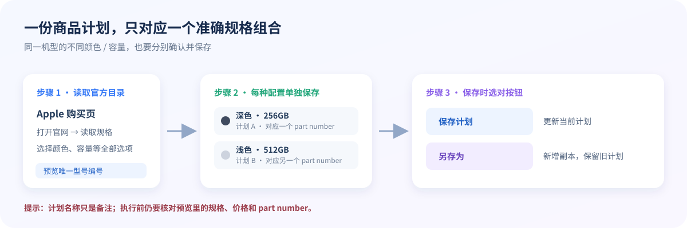

# Apple Store Assistant 用户操作说明

> 本说明对应 Git 工程当前的原生 macOS App 流程。下方图片是流程示意图，不是实际界面截图；按钮名称按当前界面编写。Apple 页面与库存会变化，界面不匹配时请以 Apple 官方页面为准并停止自动操作。

## 一眼看懂完整流程

整体可以记成：**每个准确机型/配置单独建商品计划；取货、联系人、发票与付款偏好是本机共用设置；托管到达 Apple 官方结账后，核对结果再由用户完成支付。**

## 1. 录入不同机型与规格

### 新建一个商品计划

1. 在左侧“商品与配置”中，粘贴 Apple 中国官网的 iPhone 购买页链接，例如 `https://www.apple.com.cn/shop/buy-iphone/...`。
2. 点“打开官网”，等页面加载后点“读取规格”。App 会读取该官方页面公开的可选规格，例如颜色、容量，以及对应的 Apple 型号编号。
3. 把每个规格选项都选完整。右侧预览应显示商品名称、已选规格、型号编号（`part number`）和参考价格。核对无误后再保存。
4. 填“计划名称”用于区分计划，例如“深色 256GB”。计划名称只是备注，不会改变实际型号。
5. 点“保存计划”保存或更新当前计划；点“另存为”保留当前计划并新增一个副本。若要同时保留多个颜色/容量，请为每个唯一规格组合分别保存计划。

### 已在官网选好某个具体型号

如果右侧当前页面已经是选定型号的 Apple 官方商品页，可以点“读取当前商品”，再检查预览中的型号编号和链接并保存。若页面型号与左侧计划不一致，App 会提示重新读取，避免把错误型号保存进计划。

**切换机型前的检查：**在计划下拉框确认选中的计划名称；在预览里再核对规格和 `part number`。`plans.json` 保存的是商品计划，计划切换不会改变取货门店、联系人、发票类型或付款方式；这些是本机共用偏好，切换机型后也要重新确认是否适用于本次购买。

## 2. 设置取货门店与联系人

在“取货与结账资料”展开“取货门店”卡片：

| 字段 | 怎么填 | 注意事项 |
|---|---|---|
| 国家/地区 | 当前固定为中国大陆 | 其他国家/地区尚未接入当前购买流程。 |
| 城市 | 选择计划取货城市 | 更换城市后需重新选门店。 |
| 首选门店 | 在所选城市中选 Apple Store | 这是偏好门店，不代表该店一定有货；库存和可取货状态以 Apple 结账页显示为准。 |
| 允许结账时自动选用首选门店 | 按需勾选 | 开启后会尝试在结账页定位和选择门店；首选门店无法匹配时，当前逻辑可能尝试选择第一个可取货门店。请在结账页核对最终门店。关闭后由用户在 Apple 页面手动选择。 |

在“取货联系人”卡片填写姓、名、Apple 取货通知邮箱和手机号。取货姓名应与实际购买人及证件一致，并勾选“我确认取货姓名与购买人及证件一致”。身份证件输入框只填**后四位**；默认仅保留在本次 App 会话，需要跨次保存时才勾选“在钥匙串保存后四位”。Apple 没有要求时不需要提供这四位。

## 3. 设置发票

“本次默认发票类型”决定自动结账时使用哪种发票；“编辑哪种发票预设”用于编辑对应资料。选中一个类型并填写后，可切换到另外两种类型继续准备预设。

| 发票类型 | 要填写的资料 | 说明 |
|---|---|---|
| 个人电子发票 | 发票抬头选填 | 留空时按个人默认抬头处理。 |
| 公司/其他电子发票 | 公司名称；纳税人识别号，或明确勾选“我司无纳税人识别号” | 按 Apple 页面当次要求填写。 |
| 增值税专用发票 | 公司名称、纳税人识别号、银行账号；银行名称选填 | 先阅读 Apple《发票条款》，确认有权代表公司采购、资料属实，再勾选授权项。只有授权保存后，App 才会尝试代为勾选官网条款。 |

全部资料填写完，点“保存联系人与发票资料”。保存后界面会提示资料在本机 macOS 钥匙串中。更改资料后，开始托管前要重新保存；有未保存修改时程序会停止自动填写。点“清除本机保存资料”只删除联系人和发票资料，不会删除门店、支付方式、默认发票类型等偏好。

## 4. 选择支付方式与结账方式

在“付款与下单”中，从“付款方式”选择**支付宝**或**微信支付**。此处只保存支付方式偏好；不填写也不保存支付宝/微信账号、支付密码、银行卡号或验证码。

“自动完成下单并停在待付款（不会付款）”控制结账交接：

- **开启：**资料完整且订单信息核对通过时，App 会在 Apple 官方 Review 页面核对付款方式标签和总金额（商品与数量在先前购物袋阶段核对，Review 不强制匹配门店名称），然后最多提交一次 Apple 的“立即下单”。Apple 确认生成待付款订单后，App 停止；用户再自行完成实际付款。
- **关闭：**App 把 Apple 结账页交给用户继续操作，由用户在官网选择门店、核对/填写资料和完成后续步骤。

当前工程的此项默认值为开启。每次托管前都请亲自确认复选框状态。创建待付款订单不等于付款成功，也不保证库存已保留；金额不一致会停止等待检查；当前 Review 不会因门店名称不匹配而阻止下单。请亲自确认最终门店，或关闭结账自动化后手动核对并提交。

## 5. Apple 账号与专用浏览器

真实购买流程使用 App 启动或接管的专用 Edge 配置，不是用户日常浏览器。登录发生在 Apple 官方页面；Apple 要求验证码、二次验证或重新登录时，按专用浏览器中的提示处理。专用浏览器资料会保留 Apple 登录会话，以供下次继续使用。

**当前版本的登录行为需要特别了解：**App 会尝试触发专用 Edge 自己的已保存凭据填充；页面脚本会检查账号是否匹配、密码栏是否有内容，然后至多提交一次登录。当前代码不会把密码字符串作为结果返回给 App 原生侧或写入计划/日志，但 App 能通过本机浏览器调试接口控制这个专用浏览器，因此不应把当前版本宣传成“技术上无法接触登录表单或凭据”的软件。若你不接受这项行为，请先不要用真实 Apple 账号使用当前版本；当前界面没有单独关闭此自动尝试的开关。

取货联系人和发票预设由 App 通过 macOS 钥匙串读写；“只保存在本机”说明存放位置，不等于 App 自己无法读取。当前以源码方式分享；构建脚本只做本机临时签名，尚无 Developer ID 签名、公证或独立安全审计。若后续发行可下载的安装包，应另行公布这些验证情况。

## 6. 设置时间并开始托管

1. 确认左侧当前计划，以及取货城市/门店、联系人、发票类型和付款方式。
2. 设定“抢购时间”。界面显示本机时区，底部时间预览会列出准备复核、静默开始、执行开始和执行截止时刻。
3. 设置准备、静默和执行窗口秒数。当前约束是：准备时间不得早于静默开始时间；执行窗口为 5–300 秒。默认值为准备 300 秒、静默 60 秒、执行窗口 60 秒。
4. 启动并确认专用浏览器可以访问 Apple 页面、账号状态符合预期、购物袋没有需要先处理的其他商品。
5. 点“一键托管”。托管后本次商品、设置和时间会锁定。右侧进度显示连接、登录确认、商品准备、购物袋核验和结账状态；遇到验证、页面变化、信息不匹配或结果不明时会停下提示检查。

## 7. 资料保存位置与清理

| 资料 | 保存位置 | 清理方式 |
|---|---|---|
| 商品计划（商品链接、规格、型号编号） | `~/Library/Application Support/AppleStoreAssistantNative/plans.json` | 在 App 中删除计划；也可在退出 App 后按需清理整个数据目录。 |
| 取货门店、默认发票类型、支付方式和相关偏好 | `~/Library/Application Support/AppleStoreAssistantNative/pickup-settings.json` | “清除本机保存资料”不会清除此项；可在退出 App 后单独管理本机数据。 |
| 联系人、发票及公司银行资料 | macOS 钥匙串 | 点“清除本机保存资料”。身份证后四位只有勾选保存时才跨次保留。 |
| Apple 登录会话 | App 专用浏览器资料目录 | 清除 App 数据目录会同时清除专用浏览器登录会话；请先退出 App。 |
| 任务录制 | App 数据目录中的任务录制文件 | 用于复核阶段和按钮状态；不是屏幕录像，不包含表单内容。 |

## 开始前快速核对

- [ ] 计划下拉框与预览显示的是本次要买的准确颜色、容量和型号编号。
- [ ] 首选城市/门店已经保存；若启用自动选择，已接受它可能尝试回退到其他可取货门店，并会在 Apple 页面核对。
- [ ] 姓名、邮箱和手机号正确；购买人/证件姓名确认已勾选。
- [ ] 发票类型与资料匹配；若使用增值税专票，已读条款、授权并保存。
- [ ] 支付方式为本次需要的支付宝或微信；已确认是否开启“自动完成下单并停在待付款”。
- [ ] 已了解当前专用 Edge 保存登录会话，并可能自动触发已保存凭据填充和一次登录提交。
- [ ] 已确认抢购时间、时区和右侧专用浏览器状态。

## 重要限制

商品页结构、库存和结账规则可能变化；读取规格失败或订单信息无法唯一确认时不要强行继续。进入购物袋不表示库存锁定，App 不承诺下单成功。工程尚未验证真实开售时从开售到生成待付款订单的完整链路。有关自动登录凭据的行为，请以本说明中的当前实现披露为准；正式销售前应复核并改善此边界。
